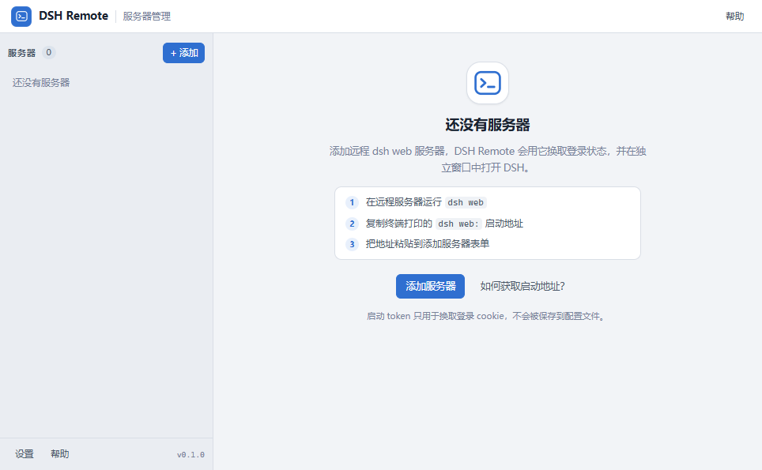
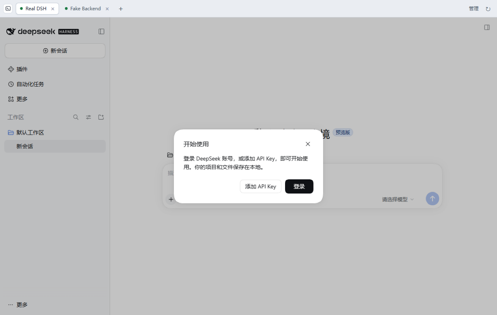

# DSH Remote

DSH Remote 是一个跨平台桌面客户端（Windows / macOS），用来在**顶部标签页**中管理并连接**远程运行的** `dsh web`（DeepSeek Harness Web UI）。

它不复制 DSH 前端、不在本地启动 DSH 后端，也不绑定 DSH 版本。它只负责：

- 保存多个远程服务器配置，并在它们之间切换；
- 首次连接时接收 `dsh web` 启动打印的带 token URL，用一次性 token 换取签名 cookie；
- 用持久 cookie 保持登录态，之后一般无需再次粘贴 token；
- 在一个主窗口的多个标签页中加载远程 DSH UI，并提供标签切换/关闭、菜单、托盘、窗口位置记忆、外链、下载、代理与证书处理。

> **未签名说明**：v1 的 Windows 安装包和 macOS 包都**未做代码签名/公证**。Windows 首次运行会出现 SmartScreen 提示，macOS 首次打开需手动放行。详见 [macOS 未签名安装](docs/macos-unsigned.md)。





## 功能

- **多服务器管理**：新增、编辑、删除、设为默认、测试连通。
- **粘贴 token URL 首次连接**：粘贴 `dsh web: https://...?token=...` 整行 URL，客户端自动完成 token 交换；保存到配置里的只有不含 token 的 base URL。
- **cookie 持久化**：每个服务器使用独立 session（`persist:dsh-remote-<id>`），cookie 互不干扰；重启客户端通常可直接进入。
- **401 重连入口**：远程后端重启或 cookie 失效时，客户端给出明确的重新认证入口，粘贴新的 token URL 即可恢复。
- **代理模式**：每个服务器可选“系统代理”（默认）或“直连”，用于公司代理误拦内网地址的场景。
- **自签名证书**：默认拒绝无效证书；可对单个服务器显式信任，仅该服务器的 origin 放行。
- **多标签页**：同一窗口顶部 Tab 栏管理多个后端；支持切换、关闭、`+` 新建、`Ctrl/Cmd+1..9` 切换、`Ctrl/Cmd+W` 关闭；重启后恢复上次打开的标签页。
- **桌面宠物**：常驻透明置顶宠物窗口，汇总所有已打开远程标签页的对话状态；可拖拽移动，点击展开对话面板，鼠标离开面板 5 秒后自动收起；右上角状态灯为：蓝色运行中、黄色等你确认、绿色刚完成，无状态时隐藏。宠物形象为原创“御姐·深蓝”，含站/坐/蹲三种动态待机，以及晨起、读写、家务、出门、运动、梳妆、厨房、出游、宴会、舞台等 18 类生活动作；尺寸可切换小/中/大；透明区域不拦截桌面点击，不占任务栏，卡片按标签页分组，可一键切换远程，默认只展开运行中、等你确认和刚完成的对话，空闲对话折叠隐藏。
- **桌面体验**：主窗口、菜单、托盘、窗口大小/位置记忆、单实例、外链交给系统浏览器、下载可用。
- 中文界面。

## 系统要求

- Windows 10 / 11 x64。
- macOS（Intel 与 Apple Silicon 均可，发布的是 universal 构建）。
- 远程服务器上已经安装并可以运行 `dsh web`。

## 安装（Windows）

### 方式一：NSIS 安装器

1. 获取 `DSH-Remote-0.1.3-win-x64-setup.exe`。
2. 双击安装。安装器是 **assisted / per-user（当前用户）** 模式，不需要管理员权限；会显示安装路径页，默认 `%LOCALAPPDATA%\Programs\DSH Remote`，可改成 `D:\Apps\DSH Remote` 等当前用户可写目录。
3. 安装器会先检测旧的 DSH Remote 安装（包括之前用 ZIP 脚本安装的版本），移除旧程序文件、快捷方式和卸载项，再安装新版本；`%APPDATA%\DSH Remote` 里的服务器配置和登录 cookie 会保留。
4. 安装器会创建开始菜单和桌面快捷方式，并在“设置 → 应用”里注册卸载项。
5. 由于安装包未签名，Windows SmartScreen 可能提示“Windows 已保护你的电脑”。选择“更多信息”→“仍要运行”即可；这是未签名应用的预期行为。
6. 卸载：Windows 设置 → 应用 → 已安装的应用 → DSH Remote。

> 部分受管 Windows 环境会直接拦截 **所有 NSIS 生成的 exe**（包括官方 Electron 安装器）。如果安装器双击后没有任何窗口、退出码为 2，请使用方式二。这不是应用本身的问题；setup.exe 的目录页无法绕过这类终端安全策略。

### 方式二：ZIP 便携包 + 安装脚本（推荐用于受管环境）

1. 获取 `DSH-Remote-0.1.3-win-x64-portable.zip` 并解压到任意目录。
2. 双击 `install.cmd`（或运行 `powershell -NoProfile -Sta -ExecutionPolicy Bypass -File install.ps1`）。
3. 脚本会先检测旧的 DSH Remote 安装（包括 NSIS 安装的版本），移除旧程序文件、快捷方式和卸载项；`%APPDATA%\DSH Remote` 里的服务器配置和登录 cookie 会保留。
4. 脚本会弹出一个输入框，默认路径为 `%LOCALAPPDATA%\Programs\DSH Remote`；直接确定使用默认值，或改成 `D:\Apps\DSH Remote` 这类当前用户可写目录。随后创建带 `--no-sandbox` 的开始菜单/桌面快捷方式，并注册卸载项。
5. 无人值守安装可显式指定路径，跳过输入框：

   ```powershell
   powershell -NoProfile -Sta -ExecutionPolicy Bypass -File install.ps1 -InstallDir "D:\Apps\DSH Remote"
   ```

6. 卸载：从“设置 → 应用”卸载，或运行安装目录下的 `uninstall.ps1`。

> NSIS 一键安装器使用固定的 `%LOCALAPPDATA%\Programs\DSH Remote`。需要自定义路径时请用 ZIP 的安装脚本。

也可以不解压安装，直接运行 `DSH Remote.exe --no-sandbox`。

## 首次连接

1. 在**远程服务器**上启动 DSH Web UI（`dsh web` 是 `dsh --profile web` 的简写）：

   ```sh
   dsh web --host 10.0.0.7 --no-open
   ```

   `--host` 必须是一个具体的本机 IPv4/IPv6 地址（通配地址会被拒绝）。`--no-open` 让服务器端不尝试打开浏览器，启动输出里仍会打印 URL。

2. 在启动输出中找到形如下面的一行（token 已省略）：

   ```
   dsh web: http://10.0.0.7:3080/?token=...
   ```

3. 在 DSH Remote 中点击“添加服务器”，把**整行 URL（含 token）**粘贴进去，然后连接。
4. 客户端用这个一次性 token 换取签名 cookie，随后只保存干净的 base URL（如 `http://10.0.0.7:3080/`）。token 不写入配置、不写日志、不显示在窗口标题里。
5. token 是 DSH 进程的启动凭据，只应粘贴到你自己的客户端；不要发到聊天、工单或截图里。

如果服务器在反向代理或 TLS 之后，请先按 [远程服务器指南](docs/remote-server.md) 配置 `--public-url` / `--trusted-host`，再用代理入口地址连接。

## 窗口宽度

- 首次打开主窗口时按屏幕工作区约 85% 设置宽度（上限 1800px，高度约 90%），比旧的固定 1280px 更接近浏览器。
- “设置 → 主窗口宽度”支持：自适应、1280、1440、1600、1920、自定义 900–4000px。
- 修改后立即调整已打开的主窗口，并持久化；重启后保持。
- “自适应”会按屏幕重新计算，手动拖拽后的窗口大小也会被记住。
- 固定宽度优先于手动拖拽；想以后都按拖拽大小启动，请选择“自适应”。

## 多个服务器与标签页

- 服务器列表支持新增、编辑、删除、设为默认和测试连通。
- 每个服务器打开为一个顶部标签页；标签页可切换、关闭，`+` 选择已有服务器，右键有刷新/在浏览器打开/清除登录状态。
- 快捷键：`Ctrl/Cmd+T` 新建标签页，`Ctrl/Cmd+W` 关闭当前标签页，`Ctrl/Cmd+1..9` 切换标签页，`Ctrl/Cmd+R` 重新加载当前标签页。
- 每个标签页都有独立的 cookie/session，切换标签页不会串登录态。
- 重启后会恢复上次打开的标签页和当前标签页。
- 删除服务器时会清理对应的 session 数据并关闭标签页。
- 可通过托盘菜单或应用菜单快速切换服务器。

## Cookie 持久化与 401 恢复

- DSH 的启动 token 只用于换取 cookie，cookie 保存在客户端对应服务器的 session 目录中。
- 关闭客户端再打开（远程后端未重启）通常可以直接进入，不需要重新粘贴 token。
- 以下情况可能返回 401：远程 DSH 进程重启且签名密钥变化、cookie 过期、手动清理了登录数据。此时客户端会显示重新认证入口：
  1. 回到远程服务器，重新复制新的 `dsh web:` 整行 URL；
  2. 在认证窗口中粘贴并连接。
- 客户端不会自动读取远程终端输出，所以 token 需要手动复制一次。

## 代理

- 每个服务器可单独选择代理模式：
  - **系统代理**（默认）：跟随操作系统代理设置。
  - **直连**：忽略系统代理。公司代理误拦内网/本地地址时使用。
- 修改代理模式后，客户端会断开现有连接并重新加载该服务器。
- v1 不支持客户端证书。

## 自签名证书

- 默认拒绝无效证书，避免中间人风险。
- 如果目标服务器使用自签名或内部 CA 证书，可在该服务器的设置中开启“允许无效证书”。该开关**只对该服务器生效**，其他服务器仍按默认策略校验证书。
- 开启前请确认你信任该服务器和网络路径；不要把该开关当作默认配置。
- 更推荐的做法是为远程 DSH 配置受信任的证书，或由反向代理统一终止 TLS。
- DSH 的实时连接使用 `wss://`。客户端会按同一 host:port 把 HTTPS 页面的证书信任应用到对应的 WSS 连接；如果自签名 HTTPS 下页面能打开但左侧数据不加载，请确认日志里没有 `Rejected certificate ... wss://`。0.1.0 已修复此前 WSS 被误判为“未配置 origin”而拒绝的问题。

## 安全边界

- 远程 DSH 页面加载在主窗口的标签页中（Electron `WebContentsView`）：`nodeIntegration: false`、`contextIsolation: true`、`sandbox: true`，**没有 preload、没有 Node 权限**，远程页面无法访问本地文件、执行命令或调用任何本地 IPC。
- Windows 快捷方式默认带 `--no-sandbox`：部分企业 Windows/Insider 环境会在应用启动前终止 Electron 的 Chromium sandbox（`STATUS_BREAKPOINT`）。这降低了 OS 级沙箱这一层，但**没有改变**上面的 Node/preload/IPC 边界。若你的机器没有这个问题，可以编辑快捷方式去掉该参数，或直接运行 `DSH Remote.exe`。
- 本地管理页面只通过 preload 暴露最小化的、经过校验的 API。
- 启动 token 不落盘、不写日志；涉及 URL 的错误信息会脱敏。
- 外部链接交给系统浏览器；`file:`、`javascript:`、`data:` 等顶层导航会被拒绝。
- 下载走 Electron 默认下载流程，保存到系统下载目录。
- 客户端不提供 SSH 隧道、VPN 或反向代理；远程端口如何暴露由服务器和网络负责。请只把端口暴露给可信网络或可信代理，详见 [远程服务器指南](docs/remote-server.md)。

## 已知限制

- 不在本地启动、安装或管理 DSH 后端。
- 不支持 Linux。
- v1 没有自动更新、代码签名、公证和 Mac App Store 分发。
- 不支持客户端证书、SSH 隧道、VPN。
- 远程 UI 的内容由远端 `dsh` 版本决定；客户端不复制也不定制 DSH 前端，因此升级 DSH 后无需更新客户端。
- 每个打开的标签页对应一个 Chromium 渲染进程，后台标签页默认继续运行；标签页越多，内存占用越高。

## 从源码构建

需要 Node.js 22+ 和 npm。

```sh
npm ci

npm run dev        # 开发模式（electron-vite）
npm run typecheck  # 类型检查
npm run test:unit  # 单元测试
npm run build      # 编译到 out/

npm run icons      # 重新生成 build/ 下的图标（已提交，一般不需要）
npm run dist:win   # Windows：编译并打 NSIS 安装包
npm run package:win-zip  # Windows：生成带 install.cmd 的便携 ZIP
npm run dist:mac   # 仅 macOS：编译并打 universal dmg + zip
```

说明：

- 打包产物输出到 `dist/`（已在 `.gitignore` 中忽略）。
- `dist:win` 产出 `dist/DSH-Remote-0.1.3-win-x64-setup.exe`；`dist:portable` 产出同目录的 portable exe；`dist:mac` 产出 `dist/DSH-Remote-0.1.3-mac-universal.dmg` 和 `.zip`。
- 受管 Windows 环境下建议分发 `dist/DSH-Remote-0.1.3-win-x64-portable.zip`（包含 `install.cmd`），它不依赖 NSIS。
- `dist:mac` 只能在 macOS（或 CI 的 macOS runner）上执行；universal 构建会同时打包 x64 与 arm64。
- 所有产物都未签名：Windows 会有 SmartScreen 提示，macOS 首次打开需要放行，见 [macOS 未签名安装](docs/macos-unsigned.md)。
- 图标由 `scripts/generate-icons.mjs` 用 Node 标准库绘制，再用 `png2icons` 生成 `.ico` / `.icns`；图案为自制，不使用官方 DSH 商标素材。
- CI 配置见 `.github/workflows/build.yml`：Windows 与 macOS 两个 job 分别跑单元测试、打包并上传 artifact。

## 文档

- [远程服务器指南](docs/remote-server.md)：`dsh web` 的监听、`--public-url`、`--trusted-host`、TLS、反向代理、token URL、防火墙与 SSH。
- [macOS 未签名安装](docs/macos-unsigned.md)：Gatekeeper 放行、`xattr`、本地构建、CI 与未来签名。
- [设计说明](docs/superpowers/specs/2026-11-17-dsh-remote-electron-design.md)。
## 许可证

MIT，详见 [LICENSE](LICENSE)。


